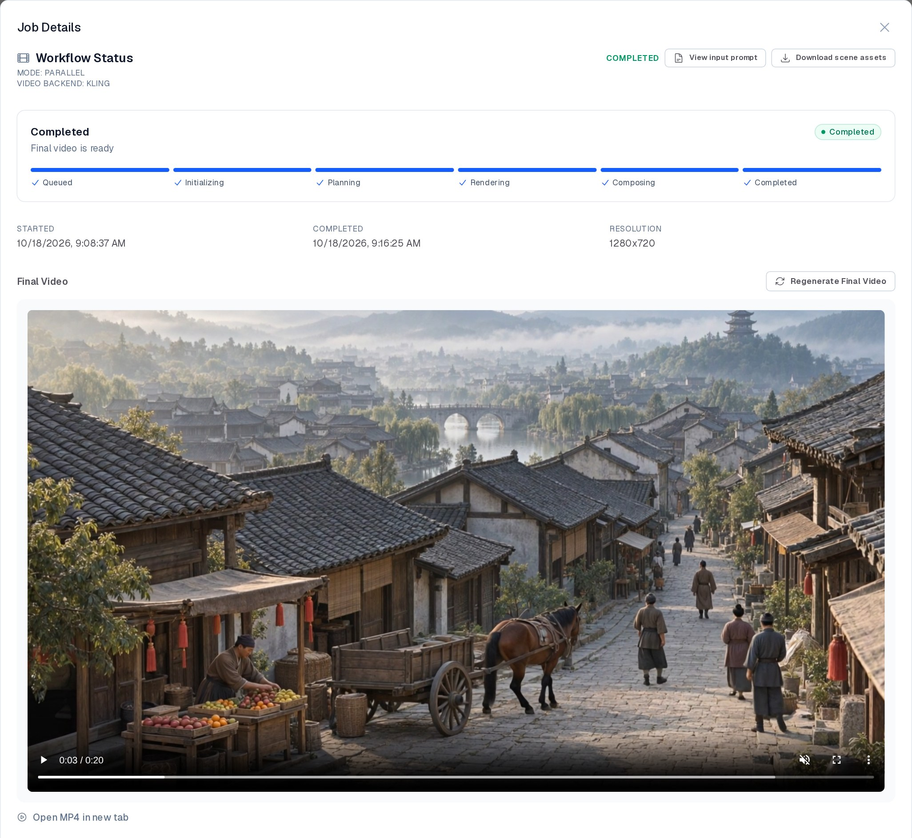
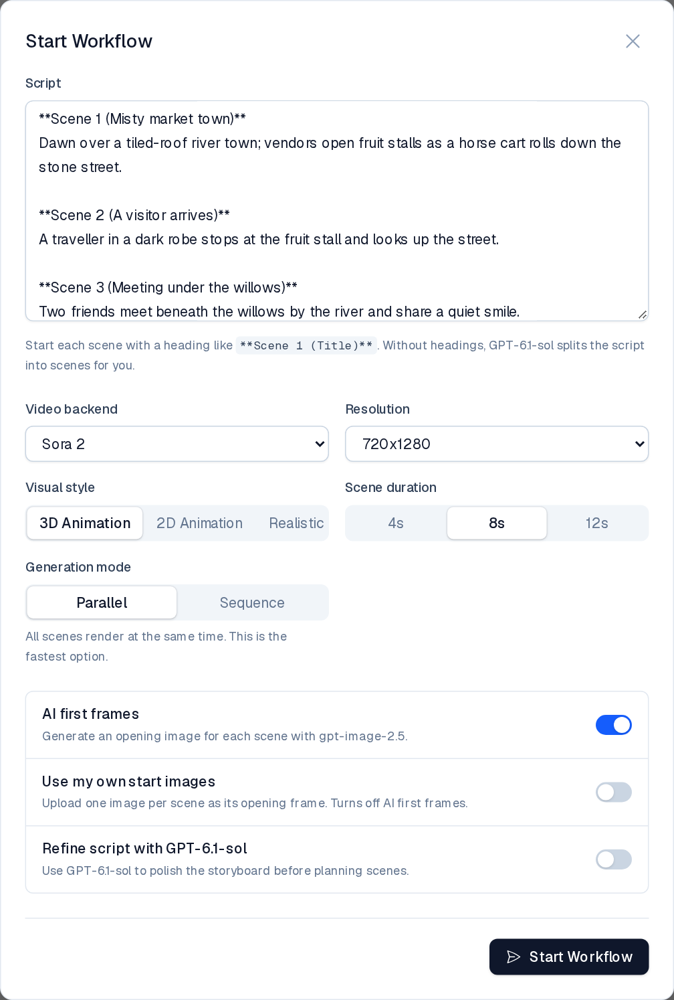
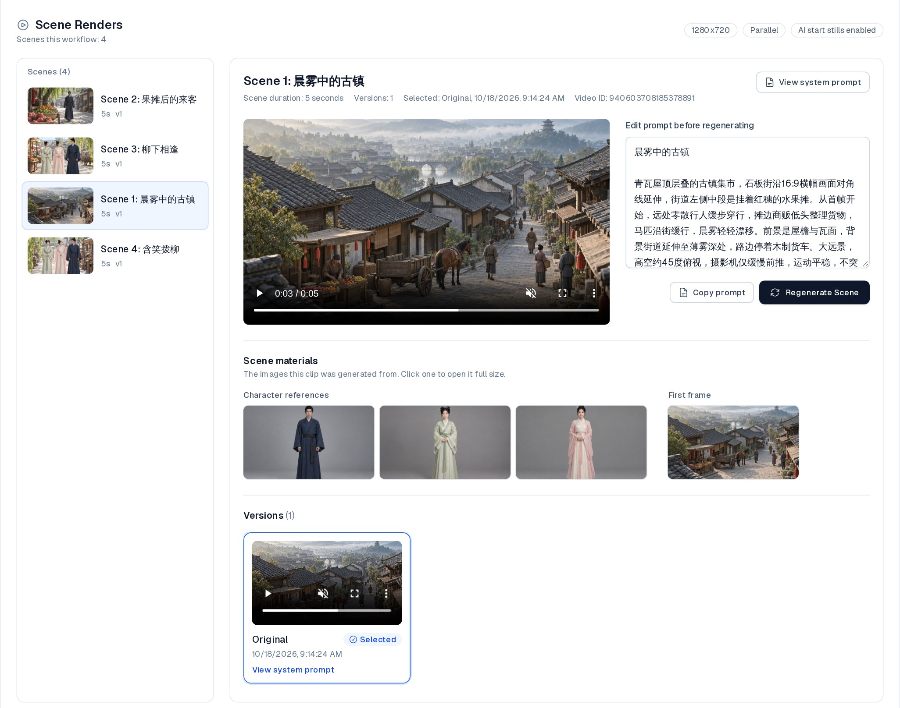
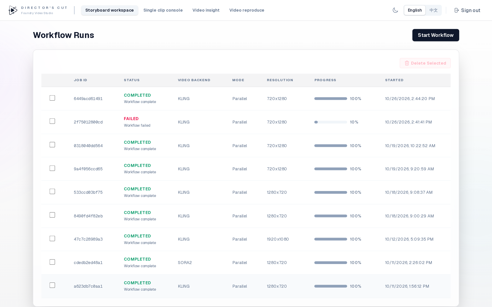
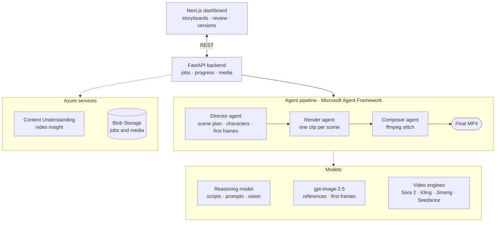

<div align="center">


# Director's Cut — Foundry Video Studio

**Turn a storyboard into a finished multi-scene video with AI agents on Microsoft Foundry.**

[](https://www.python.org/)
[](https://fastapi.tiangolo.com/)
[](https://nextjs.org/)
[](docs/deployment.md)

[Getting started](docs/getting-started.md) · [Configuration](docs/configuration.md) · [Deployment](docs/deployment.md) · [API](docs/api.md) · [中文](README.zh.md)



</div>

## What it does

Paste a script. A Director agent splits it into scenes, designs consistent characters, and paints an opening frame for each shot. A render agent generates every clip with the video model of your choice, and a Composer agent stitches them into one MP4. You review each scene in the dashboard, rewrite a prompt, regenerate or remix just that shot, and recompose the final cut. No need to start over.

## Features

- **Storyboard to final cut** — `**Scene N (Title)**` blocks become scene prompts, clips, and a stitched video; scripts without headings are split for you.
- **Four video engines** — Sora 2 on Azure OpenAI, Kling, Jimeng, and Seedance, selectable per job.
- **Consistent characters** — characters are extracted from the script and rendered as reference images, and each scene is generated with the references of the characters it contains.
- **AI first frames** — gpt-image-2.5 paints each scene's opening frame in the chosen style (3D, 2D, or realistic); or bring your own images.
- **Per-scene control** — edit a prompt, regenerate or remix one scene, keep every version, and choose which one goes into the final cut.
- **Video insight & reproduce** — analyze an existing video with Azure Content Understanding, then re-create it segment by segment in a new style.
- **Bilingual dashboard** — English and Chinese UI, light and dark themes.
- **Cloud-ready** — one script deploys to Azure Container Apps, with jobs persisted to private Blob Storage.

## Screenshots

<table>
  <tr>
    <td width="50%"></td>
    <td width="50%"></td>
  </tr>
  <tr>
    <td align="center"><b>Start a workflow</b> — script, engine, style, and options</td>
    <td align="center"><b>Direct each scene</b> — prompt, references, and versions</td>
  </tr>
</table>

<p align="center"></p>

## Architecture



The Director calls the reasoning model and gpt-image-2.5 for scene plans, character references, and first frames; the Render agent calls the selected video engine. Job state lives in TinyDB, mirrored to Blob Storage in the cloud. Video insight and video reproduce reuse the same building blocks for existing footage.

## Quick start

```bash
cp .env.example .env              # add your Azure OpenAI / Foundry settings
python -m venv .venv && source .venv/bin/activate
pip install -r requirements.lock
(cd frontend && npm install)
./start-dev.sh                    # API on :8000, dashboard on :3000
```

Open http://localhost:3000, click **Start Workflow**, and paste a storyboard. Full setup, including each video engine's credentials, is in [Getting started](docs/getting-started.md).

## Documentation

| Guide | Covers |
|---|---|
| [Getting started](docs/getting-started.md) | Local setup, typical workflow, CLI, project layout, tests, troubleshooting |
| [Configuration](docs/configuration.md) | Models, video engines, Entra sign-in, video insight, storage |
| [Deployment](docs/deployment.md) | Azure Container Apps, updates, persistent storage |
| [API reference](docs/api.md) | Every REST route |

---

<sub>Built by Ming Gu (AI GBB team) on Microsoft Azure.</sub>
