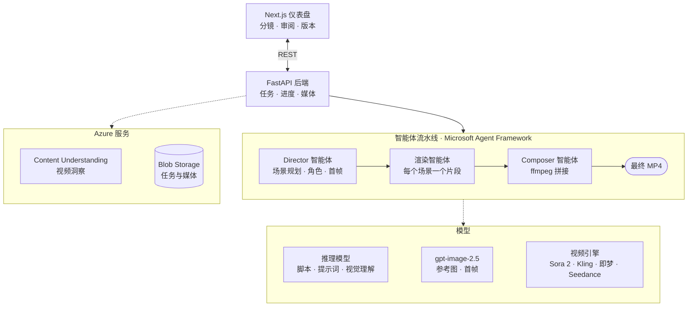

<div align="center">


# Director's Cut — Foundry Video Studio

**基于 Microsoft Foundry 的多智能体视频工作室：把一份分镜脚本变成完整的多场景成片。**

[](https://www.python.org/)
[](https://fastapi.tiangolo.com/)
[](https://nextjs.org/)
[](docs/deployment.md)

[快速上手](docs/getting-started.md) · [配置](docs/configuration.md) · [部署](docs/deployment.md) · [API](docs/api.md) · [English](README.md)


</div>

## 简介

粘贴一份脚本：Director 智能体将其拆分为场景，设计统一的角色形象，并为每个镜头绘制首帧；渲染智能体用你选择的视频模型生成每个片段；Composer 智能体把它们拼接成一个 MP4。你可以在仪表盘中逐场景审阅、改写提示词、单独重新生成或 remix 某个镜头，再重新合成成片，无需从头再来。

## 功能

- **从分镜到成片**：`**Scene N (Title)**` 段落依次变为场景提示词、视频片段和拼接成片；没有标题的脚本会被自动拆分。
- **四种视频引擎**：Azure OpenAI 上的 Sora 2、Kling、即梦（Jimeng）和 Seedance，可按任务选择。
- **角色一致**：从脚本中提取角色并生成参考图，每个场景都使用其中出场角色的参考图生成。
- **AI 首帧**：gpt-image-2.5 按所选风格（3D、2D 或写实）为每个场景绘制首帧，也可以上传自己的图片。
- **逐场景把控**：编辑提示词，单独重新生成或 remix 某个场景，保留所有版本，并选择哪个版本进入成片。
- **视频洞察与复刻**：用 Azure Content Understanding 分析现有视频，再逐段以新风格重新生成。
- **双语仪表盘**：中英文界面，支持浅色与深色主题。
- **一键上云**：一条脚本部署到 Azure Container Apps，任务数据持久化到私有 Blob Storage。

## 截图

<table>
  <tr>
    <td width="50%"></td>
    <td width="50%"></td>
  </tr>
  <tr>
    <td align="center"><b>启动工作流</b>：脚本、引擎、风格与选项</td>
    <td align="center"><b>逐场景导演</b>：提示词、参考图与版本</td>
  </tr>
</table>

<p align="center"></p>

## 架构



Director 调用推理模型和 gpt-image-2.5 生成场景规划、角色参考图与首帧；渲染智能体调用所选的视频引擎。任务状态保存在 TinyDB 中，云端会同步到 Blob Storage。视频洞察与视频复刻复用同一套能力来处理已有素材。

## 快速开始

```bash
cp .env.example .env              # 填写 Azure OpenAI / Foundry 配置
python -m venv .venv && source .venv/bin/activate
pip install -r requirements.lock
(cd frontend && npm install)
./start-dev.sh                    # API 在 :8000，仪表盘在 :3000
```

打开 http://localhost:3000 ，点击 **Start Workflow**（启动工作流）并粘贴分镜脚本。完整安装步骤（包括各视频引擎的凭据）见[快速上手](docs/getting-started.md)。

## 文档

| 指南 | 内容 |
|---|---|
| [快速上手](docs/getting-started.md) | 本地安装、典型流程、命令行、项目结构、测试、常见问题 |
| [配置](docs/configuration.md) | 模型、视频引擎、Entra 登录、视频洞察、存储 |
| [部署](docs/deployment.md) | Azure Container Apps、更新、持久化存储 |
| [API 参考](docs/api.md) | 全部 REST 路由 |

详细文档目前为英文版。

---

<sub>由 Ming Gu（AI GBB 团队）基于 Microsoft Azure 构建。</sub>
